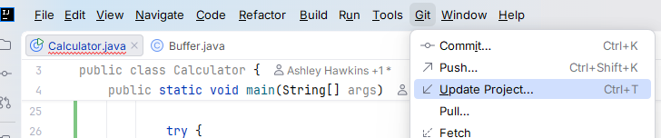
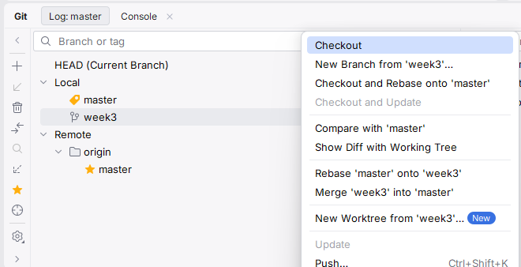

# IDE Skills: *Week Three Instructions*
## Contents
 - How to start the workshop
 - Using multi-caret to improve your productivity
 - Viewing Documentation within the IDE
 - Using Control Click to navigate source code

## Getting Started
 > [!IMPORTANT]
 > If you've missed our previous workshops, need 
 to [install IntelliJ](https://www.jetbrains.com/help/idea/installation-guide.html), and learn how to [clone a 
 repository](https://www.jetbrains.com/guide/java/tutorials/creating-a-project-from-github/clone-from-github/). 

### If you haven't already cloned the repository:

 - Clone the repository found at [this link](https://github.com/jojProgramming/IDE-Skills-Calculator).

### If you have cloned the repository:

 - Open the project in IntelliJ
 - Press the top menu button and then "Update Project" under the Git tab.  
  

### Once you've opened the project:

 - Click the Git Button  
  
 - In the Git tab, right-click "Week 3" and select "Checkout"  
  
 - You can now start the workshop

## The Workshop
We've set tasks again using the syntax below. Find them, completing them in an order of your choosing.

```java
    //todo The task
```

### Using Multicaret to improve your productivity
You can select multiple positions for your input caret by holding down the `Alt` key and clicking in different 
places. Try it in the example project where you think it might be useful.

### Viewing Documentation
You can view documentation for a method or class by hovering over it and pressing `Ctrl + Q`, pressing again to open 
it in a tool window. Use it throughout the example project to understand how a function or class works **without** reading the code.

### Using Control Click to navigate source code
You can navigate to the source code of a method or class by holding down the `Ctrl` key and clicking on it. Use it 
within the example project to view code where we have omitted documentation.